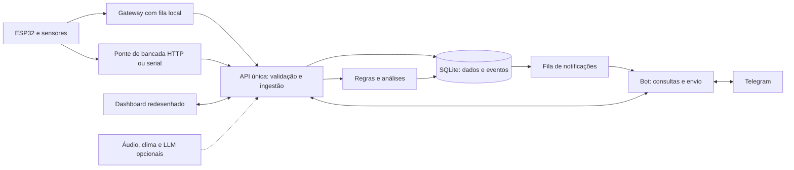

# Plano de implementação — Tekó Biotech V2

Data: 16/11/2026. Revisão 2 após análise de lacunas. Entrega 0 executada com bloqueios de rede/dependências registrados no [relatório](docs/ENTREGA-0-PREPARACAO-V2.md); entregas funcionais ainda não executadas.

Entrega 1 em revisão: [prévias navegáveis Campo e Observatório](docs/ENTREGA-1-PREVIAS-V2.md) implementadas com dados fictícios, sem integração funcional. A escolha da direção pelo usuário permanece pendente.

Este documento orienta a evolução do fork `Jet-black999/Teko-biotech-V2`. A base local examinada é a main no commit `73dc025`. A [análise dos repositórios](docs/ANALISE-MIGRACAO-V2.md) registra as fontes e divergências encontradas. O acesso remoto deverá ser conferido na preparação da implementação, pois a consulta anterior ao GitHub falhou por DNS.

## 1. Objetivo e decisões acordadas

Construir uma versão própria que reúna as melhores funcionalidades disponíveis, com uma experiência visual redesenhada e um fluxo confiável entre sensor, API, dashboard e Telegram.

Decisões de produto:

- Redesenhar as telas e a navegação. Os frontends anteriores são referências funcionais; sua estrutura visual não é requisito da V2.
- Selecionar funcionalidades pela utilidade e confiabilidade, independentemente de qual desenvolvedor ou branch as criou.
- Funcionar primeiro em notebook local, com consulta pelo computador e pelo celular na mesma rede.
- Manter perfis de medição configuráveis: o produto não depende da escolha definitiva de um sensor.
- Ter uma API oficial, um dashboard principal e um bot oficial, com uma fonte consistente para leituras e alertas.
- Fazer coleta, histórico e consulta funcionarem sem depender de áudio, LLM, clima externo ou simulador 3D.
- Separar demonstração, medição física e resultado estimado em todas as interfaces.

Ainda serão decididos na entrega visual: estilo, navegação final, tecnologia do frontend e apresentação de gráficos. Não há decisão antecipada de manter React ou reescrever tudo em outra ferramenta.

## 2. Escopo e prioridades

| Prioridade | Resultado |
| --- | --- |
| P0 — caminho operacional | Uma leitura identificada entra na API, persiste, aparece no painel e pode ser consultada no Telegram; uma regra experimental gera alerta com envio confirmado. |
| P1 — experiência principal | Novas telas responsivas, histórico, detalhes do ponto, alertas, estado de conexão, configuração local simples e integração física escolhida. |
| P2 — recursos complementares | Áudio, visualização 3D, clima e diagnóstico assistido; restaurados individualmente após o caminho operacional. |
| Evolução posterior | Hospedagem pública, múltiplas propriedades/usuários, gestão remota e automação de equipamentos. Exigem desenho próprio de acesso e operação. |

A versão inicial atende uma instalação local e um chat autorizado. Perfis de sensores podem variar; isso não implica implementar todo tipo de análise agronômica de uma vez.

## 3. Experiência proposta para o agricultor

A tela inicial deve responder: **há dados recentes, de qual ponto e existe algo que exige atenção?** A falta de dados não pode aparecer como situação normal.

Mapa inicial de telas, a validar no protótipo:

| Tela | Conteúdo principal | Ação principal |
| --- | --- | --- |
| Início | Resumo dos pontos, horário da última atualização, ocorrências e conexão | Abrir ponto ou alerta |
| Pontos de monitoramento | Nome/local do ponto, canais disponíveis, última comunicação e qualidade dos dados | Selecionar ponto |
| Detalhe do ponto | Parâmetro, valor/unidade, origem, horário de aquisição, histórico e ocorrências associadas | Trocar parâmetro/período |
| Alertas | Ocorrências ativas e encerradas, regra aplicada, início e recuperação | Abrir ocorrência e consultar medições |
| Configurações | Instalação, nome dos pontos, vínculo Telegram e informações de conexão | Conferir conexão; alterações administrativas inicialmente pelo notebook |
| Demonstração | Cenários explicitamente simulados | Executar cenário sem alterar dados reais |

O histórico pode ficar no detalhe do ponto em vez de virar mais uma tela. No celular, propor poucos destinos principais e ações secundárias no detalhe. No computador, aproveitar a largura para comparação e histórico, mantendo a mesma linguagem.

Requisitos de apresentação:

- Português simples; detalhes como boot, sequência e ADC técnico ficam em uma área de diagnóstico quando necessários.
- Mostrar unidade, origem e idade do dado junto ao valor. Não depender apenas de cor para transmitir estado.
- Renderizar números com gráficos temporais, categorias como eventos/estados e booleanos com rótulos apropriados. Nunca desenhar uma curva numérica para qualquer resultado indiscriminadamente.
- Diferenciar carregando, primeira leitura pendente, API indisponível, sensor sem comunicação, leitura antiga, erro de aquisição e histórico sem resultados.
- Separar condição medida de falha de comunicação. Um sensor offline não significa que a condição monitorada está normal nem crítica.
- Exibir horários desconhecidos como desconhecidos; recebimento não substitui silenciosamente aquisição.
- Quando faltar conexão, manter apenas a última informação disponível com aviso e horário. A consulta inicial sem cache deve apresentar indisponibilidade.
- Não enviar ações de configuração para uma fila offline nesta versão.
- Na primeira versão, o dashboard consulta e exporta. Cadastro, calibração, regras, troca de vínculo e reset ficam em comandos administrativos no notebook. Edição pela interface exige uma entrega posterior com autenticação própria.
- Exportar CSV por ponto, canal e período, com unidade, origem, qualidade e horários; marcar horário desconhecido. Paginar consultas e limitar pontos por gráfico, identificando agregação ou truncamento.
- Incluir no protótipo orientação de primeira instalação e estados de sensor sem calibração ou recém-substituído.
- Garantir foco visível, navegação por teclado, rótulos nos controles, alternativa textual ao gráfico, contraste verificável e redução de animações quando solicitada pelo dispositivo.
- Revisar em larguras de 360, 390, 768 e 1366 pixels: sem rolagem horizontal da página, ações acessíveis e informação legível.

## 4. Arquitetura de destino

### API e armazenamento

- FastAPI e SQLite continuam adequados à instalação local existente. Consolidar as responsabilidades; não criar microsserviços para esta etapa.
- Usar o contrato v1 como ponto inicial de normalização de identidade, tempo, qualidade e unidade. Aproveitar os módulos especializados sem tornar todos os canais dependentes de kPa ou de uma cultura específica.
- Ter uma única fábrica de aplicação e um ciclo de inicialização/encerramento que coordene banco, tarefas e módulos opcionais. Os pontos de entrada antigos tornam-se aliases temporários ou são documentados como descontinuados.
- Rotas antigas de telemetria devem virar adaptadores para o mesmo serviço de ingestão. Não deixar rotas com gravação e alertas paralelos.
- Objetivo final: um armazenamento operacional canônico. A existência de dois bancos antigos exige importação explícita, com proveniência e mapa de IDs; não autoriza apagar ou concatenar tabelas.
- Resultados derivados registram método, versão e referências às leituras usadas. Preservar a leitura bruta e evitar recalcular retrospectivamente o histórico sem identificação da versão.
- Leituras não finitas, unidades incompatíveis e credenciais inválidas são rejeitadas; resultados zero e booleano falso continuam válidos.
- No caminho v1, manter idempotência por identidade do nó/sessão/sequência/canal e distinguir retransmissão de conflito. Adaptadores sem identidade equivalente devem declarar a limitação, não deduplicar apenas por valor/horário.
- Manter contratos compatíveis durante a transição e adicionar migrações numeradas; não editar migrações já aplicadas.

### Alertas e Telegram

- Adotar um único motor de eventos e uma fila persistente de notificação. Aproveitar reserva, confirmação e retentativas do fluxo v1/`monitoring_bot`.
- Registrar leitura, mudança de estado e solicitação de notificação de forma transacional quando pertencerem ao mesmo processamento.
- Configurar persistência da condição, recuperação/histerese e política de repetição. Regras de demonstração ficam identificadas como experimentais.
- Confirmar envio apenas após resposta válida do Telegram. Reinício e falha de rede preservam pendências.
- Na retomada, preservar os horários dos eventos e identificar entrega atrasada. Abertura e recuperação da mesma ocorrência seguem ordem causal; se ela já encerrou, a mensagem de abertura informa que é histórica e já foi recuperada. Uma abertura com envio esgotado não bloqueia indefinidamente a recuperação: esta pode ser enviada com contexto completo da ocorrência.
- Há uma janela em que Telegram aceita a mensagem e a confirmação local falha. Não prometer envio exatamente uma vez; reduzir duplicações com reserva e repetição do ACK antes de novo envio.
- Manter um consumidor de atualizações do Telegram por token. O processo pode ter worker de envio separado internamente; não executar dois bots completos com a mesma credencial.
- Aproveitar menus e áudio do fork junto de autorização, cliente da API e configuração automática recuperados da branch de recursos.
- Comandos iniciais: `/start`, `/status`, `/sensores`, `/alertas`, `/painel`, `/ajuda`. Reutilizar termos amigáveis nos botões. Recursos extras entram depois sem quebrar esses comandos.
- Consultas por texto, botão, callback e áudio seguem a mesma autorização. Áudio não concede acesso adicional nem deve ser requisito para consultar os dados.
- Bot acessa dados pela API; token do Telegram e credenciais de gateway nunca entram no frontend.

### Rede e execução local

- Na operação local, servir o build do painel e a API pela mesma origem. Durante desenvolvimento, usar proxy ou configuração central da URL.
- O iniciador deve informar a URL real para notebook e celular, distinguir modo local/demonstração e indicar claramente falha em cada serviço.
- Abrir API/painel não deve depender de concluir o vínculo Telegram. O bot pode ser conectado depois.
- Configurar IP, porta, endereço público do painel e diretórios de dados em um lugar definido. Remover URLs fixas do GitHub Pages original e `localhost` espalhado pelo frontend.
- HTTP local utiliza link comum para o painel; Mini App Telegram com HTTPS é um modo separado, se adotado.
- Conexão local pode continuar sem internet externa; Telegram e serviços externos ficam indisponíveis. A perda da API exige armazenamento no gateway; cache de tela não substitui coleta persistente.
- Manter autenticação por gateway e serviço interno. Desabilitar rotas HTTP mutantes de configuração/reset na operação inicial; executá-las por CLI local. Consultas do painel são destinadas à rede local de confiança, sem proteção de identidade por usuário nesta fase. Exposição pública fica fora do escopo local.
- Empacotar localmente os recursos essenciais do painel: scripts, gráficos, estilos, ícones e fontes necessárias. Não depender de CDN para consultar medições.
- Definir backup periódico consistente do SQLite, restauração em banco separado, diagnóstico de filas/serviços e aviso de armazenamento insuficiente antes do aceite operacional.

### Calibração, retenção e demonstração

- Registrar sensor, canal, versão, parâmetros, método e vigência de cada calibração. Associar resultados derivados à leitura bruta e à versão aplicada; alterações novas não reescrevem silenciosamente medições antigas.
- Substituir um sensor cria uma nova identidade física, mantendo o histórico do ponto. Falta de calibração admite ADC bruto, mas não uma unidade física inferida sem método registrado.
- Separar namespaces ou ambientes de demonstração e operação nos dados, regras, resets e filas. Envio de avisos de teste é explícito e identificado; reset fica restrito à demonstração.
- Dimensionar retenção após medir tamanho das amostras e definir intervalo e número de canais. O limite atual de 128 registros do gateway não representa uma autonomia garantida. Registrar capacidade, estimativa em horas, política de fila cheia e indicação de perda/bloqueio; não apagar pendências silenciosamente.
- Testar a coleta sem intervenção serial. Retentativas não devem converter a mesma leitura em uma nova amostra nem bloquear indefinidamente a aquisição sem indicação.

### Matriz de desconexão

| Falha | Comportamento esperado |
| --- | --- |
| Internet externa, LAN e notebook ativos | Coleta e painel local continuam; notificações aguardam; recursos externos mostram indisponibilidade. |
| Notebook/API indisponível | Gateway armazena dentro da capacidade declarada; painel embarcado permite consulta limitada e mostra pendências. |
| Roteador/LAN indisponível | Não prometer acesso ao painel do notebook. Validar ESP-NOW e canal de rádio; consulta ao gateway por rede local própria exige modo AP compatível com o canal dos nós e teste físico. |
| Rede retorna | Sincronizar com identidade e horário originais, sem transformar dados atrasados em medições atuais; identificar notificações históricas. |

## 5. Fontes e tratamento dos recursos

| Fonte | Aproveitar | Tratamento |
| --- | --- | --- |
| Main do fork, `73dc025` | Código mais recente, conteúdo, recursos de áudio, 3D e análise | Base da integração; revalidar novidades remotas na entrega 0 |
| Mudanças não commitadas da pasta antiga | Persistência, cadastro físico, ponte ESP32, correções de URLs, reset e indisponibilidade | Portar por responsabilidade, com comparação de conflitos |
| Branch `feat/frontend-integracao-gh-pages`, `48752ef` | `monitoring_bot`, iniciador, testes, preparação local e lógica útil do frontend | Extrair módulos com suas dependências; adaptar inicialização e banco |
| Frontends anteriores | Comportamentos, contratos, recursos úteis e elementos de marca selecionados | Redesenhar telas; não importar layouts completos como requisito |
| Firmware existente | ESP-NOW, fila LittleFS, ensaios HTTP/serial | Selecionar variantes oficiais e documentar compatibilidade |

O nome da branch `gh-pages` não significa que ela seja apenas visual: a branch de recursos contém trabalho importante do bot e do backend.

## 6. Entregas e critérios de conclusão

### Entrega 0 — Preservação e base reproduzível

**Trabalho:** conferir dependências/imports e comandos de teste em ambiente novo; registrar bloqueios e falhas iniciais; registrar commits/branches, guardar patch e arquivos novos da pasta antiga, produzir inventário com hashes e verificar que o snapshot pode ser recuperado. Separar backup privado dos bancos/configurações. Cadastrar `upstream` e manter `origin` no fork; consultar atualizações quando houver rede. Criar branch de integração a partir da main escolhida.

**Artefatos:** mapa de origem/destino por módulo; relação de conflitos; instruções de recuperação; comandos atuais para iniciar e verificar os componentes.

**Aceite:** todos os arquivos locais e os módulos exclusivos das branches estão recuperáveis; a base Git usada está registrada; nenhuma mudança depende apenas da pasta antiga sem inventário.

Não incluir tokens, `.env`, bancos de execução, `.runtime`, `.venv` e `node_modules` nos commits. Não rodar reset de demonstração nos bancos existentes para preparar a migração.

### Entrega 1 — Experiência e protótipo das novas telas

**Trabalho:** definir jornadas de consulta, alerta, primeira conexão, calibração, substituição de sensor e indisponibilidade; representar o cadastro administrativo no notebook sem prometer edição pelo dashboard; propor duas direções visuais simples; produzir uma prévia navegável da escolhida, começando por Início, Ponto e Alerta. Usar dados fictícios identificados e incluir pelo menos um estado vazio e um estado offline.

**Artefatos:** mapa de navegação, prévia mobile/desktop e conjunto inicial de cores, tipografia, espaçamentos, componentes e estados. Registrar a escolha da tecnologia em uma decisão curta, comparando manutenção, dependências, reaproveitamento de lógica e custo de integração.

**Aceite:** o usuário consegue avaliar uma prévia concreta e escolher a direção antes da construção das demais telas. Um ponto pode ser encontrado, sua atualização entendida e um alerta consultado sem detalhes técnicos obrigatórios. Essa revisão visual é parte da entrega, não bloqueia a preparação técnica independente.

### Entrega 2 — Núcleo de dados e API consolidados

**Trabalho:** definir a fábrica oficial da API; integrar cadastro físico, calibração versionada e adaptadores; estabelecer fonte de dados canônica; planejar importação dos bancos antigos; corrigir reset, confirmação de envio e tratamento de valores estimados. Combinar o ciclo de vida das tarefas sem perder os módulos opcionais.

**Artefatos:** contrato atualizado, decisões de persistência, migrações/importador com modo de inspeção, configuração e documentação de compatibilidade das rotas.

**Aceite:** ingestão autenticada, duplicata e conflito funcionam; reinício preserva leituras; a mesma consulta retorna a mesma medição; instalação vazia não cria histórico físico fictício; reset não apaga dados físicos; módulo opcional indisponível não impede a inicialização básica.

### Entrega 3 — Primeira integração completa

**Trabalho:** conectar uma tela da prévia à API real e recuperar os comandos básicos de `monitoring_bot`, já com autorização de chat e operações administrativas protegidas. Criar uma regra experimental e um cenário simulado com identidade rastreável. Adaptar o iniciador para a configuração oficial e permitir iniciar sem Telegram.

**Artefatos:** fluxo executável de leitura → armazenamento → tela → consulta Telegram → alerta; roteiro curto e identificação dos dados usados.

**Aceite:** painel e bot mostram o mesmo ponto, valor, unidade e horário; alerta é persistido e confirmado após envio real quando houver credencial/conexão; queda da API mostra indisponibilidade; a recuperação da condição encerra a ocorrência; nenhum segundo emissor está ativo.

### Entrega 4 — Bot oficial e notificações resilientes

**Trabalho:** incorporar menus e identidade desejados do fork; estender a autorização já existente às novas entradas; unificar fila e worker; definir retentativas e pendências esgotadas; oferecer vínculo local sem edição manual de vários arquivos. Retirar inicializadores concorrentes do fluxo recomendado.

**Artefatos:** bot oficial, catálogo de comandos e guia de diagnóstico com erros compreensíveis.

**Aceite:** chat não autorizado não recebe dados; perda de rede preserva alerta; retomada continua o processamento; falha de confirmação não provoca reenvio imediato; mensagens mantêm origem, unidade e contexto; painel enviado pelo bot abre no celular da mesma rede.

### Entrega 5 — Dashboard principal redesenhado

**Trabalho:** completar as telas definidas na entrega 1; implementar exportação CSV, paginação, limites de gráficos, histórico e filtros, seleção de pontos/canais, detalhes de alertas e configurações necessárias. Conectar somente às rotas oficiais. Incorporar estados de erro, carregamento e reconexão. Adicionar cache de leitura apenas se tiver comportamento explícito e teste de desatualização.

**Artefatos:** interface principal, build servido pela instalação local e documentação dos fluxos.

**Aceite:** navegação completa em celular e desktop; dados reais/simulados distinguíveis; tipos numérico/categórico/booleano coerentes; histórico não muda de unidade silenciosamente; recarregar uma rota funciona; acessibilidade e larguras previstas verificadas; nenhuma tela depende do servidor do repositório original.

### Entrega 6 — Hardware e continuidade da coleta

**Trabalho:** selecionar firmware oficial do nó/gateway e perfil do sensor disponível; implementar aquisição periódica com intervalo configurável e comportamento explícito para leitura pendente; construir painel leve de consulta no gateway, acessível com notebook indisponível; incluir calibração física e substituição de sensor; ajustar adaptadores; testar ponte de bancada se utilizada; dimensionar fila/retenção segundo frequência e tamanho de amostra; documentar limites, indicação de fila cheia e referência de tempo.

**Artefatos:** capacidade da fila expressa em registros e tempo de autonomia para a configuração de coleta; configuração de exemplo sem segredos, matriz placa/firmware/contrato e procedimento de gravação/diagnóstico.

**Aceite:** ensaio físico rastreado da placa até painel e bot; interrupção/reconexão com reenvio sem duplicação no caminho que oferece identidade persistente; reinício do gateway preserva a fila declarada persistente; tempo desconhecido não faz leitura atrasada parecer atual. Limitações da ponte em RAM ficam explícitas.

### Entrega 7 — Recursos opcionais selecionados

**Trabalho:** adicionar áudio, LLM, clima e 3D um por vez, conforme valor para a experiência. Reaproveitar o código existente com contratos e limites claros. A função de cada recurso deve ser descrita antes de habilitá-lo por padrão.

**Aceite:** recurso desligado ou indisponível não quebra coleta, painel e comandos básicos; áudio usa a mesma autorização; gráficos/3D identificam o que é simulação; diagnóstico distingue observação e estimativa, identifica dados insuficientes e não inventa leituras. Alegações agronômicas ficam condicionadas à validação dos sensores/métodos.

### Entrega 8 — Consolidação e aceite da V2

**Trabalho:** validar o sistema completo, configurar rotina de backup/restauração e diagnóstico de espaço/serviços, atualizar README e contratos, registrar limites conhecidos e modo de recuperação; arquivar entradas antigas depois de mapear referências e confirmar que não estão em uso.

**Aceite:** uma instalação nova consegue preparar e iniciar pelo guia; usuário valida notebook e celular; a matriz de testes está preenchida com resultados; documentação aponta para um fluxo oficial; a versão anterior pode ser recuperada com procedimento conhecido.

## 7. Dependências e organização do trabalho

Ordem principal: **0 → 1/2 → 3 → 4/5/6 → 7 → 8**. As entregas 1 e 2 podem avançar independentemente; a entrega 3 exige um contrato de dados e uma tela definida. A ausência de hardware não bloqueia o simulador identificado, mas impede declarar o aceite físico concluído.

Se os três desenvolvedores participarem:

| Frente | Responsabilidade |
| --- | --- |
| Dev 1 — usuário | API, banco, migração, alertas, contratos e integração do bot |
| Dev 2 | Experiência, protótipo e dashboard; integração dos recursos visuais selecionados |
| Dev 3 | Firmware, configuração de bancada, calibração e ensaios de desconexão |

O bot e a interface combinam seus contratos com o Dev 1 antes de alterar formatos. Se o trabalho ficar concentrado em uma pessoa, manter as mesmas entregas em sequência; não depender da disponibilidade dos outros para preservar e preparar o fork.

Usar branches pequenas por entrega e commits por responsabilidade. Registrar em cada revisão: origem dos trechos reaproveitados, comportamento novo, validação feita e limitações. Atualizações futuras do original entram primeiro por comparação em branch própria; não sincronizar automaticamente sobre uma integração em andamento.

Não há prazo fechado neste plano: estimar cada entrega após o inventário e a decisão visual, usando o tempo real disponível e o hardware acessível.

## 8. Migração de dados, corte e recuperação

1. Inspecionar cópias dos bancos antigos e contar registros por origem/tipo; não executar experimentos nos únicos bancos existentes.
2. Mapear IDs, unidades, horários, perfis, estados de alerta e notificações. Marcar tempo/proveniência desconhecidos; não fabricar metadados.
3. Executar importação em banco de destino separado, com versão do importador, relatório de rejeições e chave de origem que torne a repetição idempotente.
4. Conferir contagens e amostras. Dados históricos importados não disparam novos alertas automaticamente. Pendências de envio exigem política explícita para não reenviar mensagens já entregues.
5. No corte, interromper escritores/emissores antigos, fazer snapshot final consistente e importar o restante antes de habilitar o serviço novo. Não manter dois emissores de alertas para a mesma instalação.
6. Para recuperação, parar os serviços novos e preservar os dados gerados neles. Restaurar a versão anterior com seu banco compatível e reconciliar dados posteriores separadamente; não apontar código antigo para esquema novo sem compatibilidade demonstrada.

## 9. Matriz mínima de validação

| Área | Cenários exigidos |
| --- | --- |
| Ingestão | Token inválido; leitura válida; repetição; conflito; zero/falso; erro do sensor; tempo desconhecido; leitura atrasada |
| Persistência | Reinício; importação repetida; migração interrompida; reset de demo preservando físico |
| Contratos | Mesmos dados em adaptadores, painel e bot; unidade/perfil/versionamento consistentes |
| Alertas | Persistência da condição; recuperação; repetição; reinício; histórico sem notificação retroativa |
| Telegram | Autorização; conflito de polling; indisponibilidade; limitação de taxa; confirmação perdida; tentativas esgotadas |
| Interface | Vazio; carregando; falha; leitura antiga; reconexão; filtros; acesso direto a uma rota; teclado e telas previstas |
| Hardware | API fora do ar; fila; limite de armazenamento; reinício; reenvio; aquisição sem relógio confiável |
| Operação | Preparação nova; início sem Telegram; acesso LAN; restauração de backup; disco cheio; módulos opcionais desligados |
| Desconexão | Internet externa ausente com LAN ativa; notebook indisponível; roteador/LAN indisponível; retomada e identificação de dados antigos |
| Calibração | Sem calibração; nova versão; troca de sensor; histórico preservado e associado aos parâmetros originais |
| Exportação | Período e paginação; valores zero/falso; unidade e origem; aquisição desconhecida; agregação de gráfico sem alterar o CSV |

Usar testes automatizados para contratos, migrações e estados críticos, com serviços externos simulados. Fazer ensaios reais separados para Telegram, navegador e ESP32, registrando ambiente e resultado. Não reutilizar números de testes antigos como evidência da V2.

## 10. Registro de decisões e acompanhamento

Registrar decisões em `docs/decisoes/` durante as entregas: interface/tecnologia; fonte de dados e migração; entrada da API; bot/fila; firmware oficial. Cada registro deve explicar a escolha, alternativas relevantes e consequências práticas.

Checklist de execução:

- [x] E0: preservação e preparação do fork; instalação limpa e execução funcional pendentes por dependências/rede, conforme relatório.
- [ ] E1: protótipo visual revisado e direção escolhida — [prévias disponíveis](docs/ENTREGA-1-PREVIAS-V2.md), aguardando revisão do usuário.
- [ ] E2: núcleo de dados e API consolidados.
- [ ] E3: primeiro fluxo completo demonstrado.
- [ ] E4: bot e notificações consolidados.
- [ ] E5: dashboard principal concluído.
- [ ] E6: hardware e retenção validados.
- [ ] E7: recursos opcionais selecionados integrados.
- [ ] E8: documentação e aceite final da V2.

Este plano substitui as recomendações anteriores de preservar o layout ou escolher React antecipadamente. Os documentos antigos continuam como registro técnico. A execução começa pela entrega 0; não é necessário escolher o sensor ou resolver todas as telas antes de preservar o trabalho.
