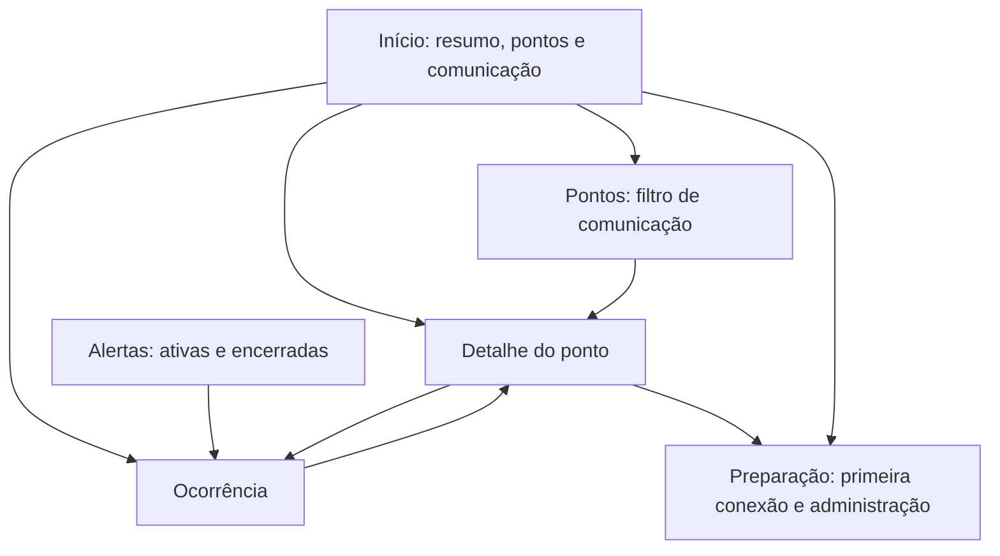

# Entrega 1 — prévias das novas telas

Data: 16/11/2026. Branch: `chore/preparacao-v2`. Estado: **prévias implementadas; revisão do usuário e escolha de direção pendentes**. O aceite da E1 permanece aberto no plano.

## Objetivo e acesso

Permitir encontrar um ponto, entender quando a leitura foi adquirida e consultar uma ocorrência sem diagnóstico técnico obrigatório. Comparar as propostas antes de construir o dashboard integrado.

Abra [`prototipo-v2/index.html`](../prototipo-v2/index.html) no navegador. O [guia da prévia](../prototipo-v2/README.md) contém o comando opcional de servidor local e o roteiro de avaliação. Não requer npm, pip, API ou internet.

Todos os nomes, locais, sensores, valores, datas e regras da prévia são fictícios. Não há migração funcional, leitura de bancos ou chamada ao Telegram. O símbolo da marca é provisório. A origem de todos os exemplos é simulação, inclusive nos cenários que representam calibração e substituição de hardware.

## Duas direções para comparar

| Direção | Proposta | Uso da tela |
| --- | --- | --- |
| **A · Campo** | Fundo claro quente, verde floresta, títulos serifados e espaços mais amplos | Cartões individuais; leitura simples do resumo e de cada ponto. Abre por padrão como proposta inicial. |
| **B · Observatório** | Fundo frio, azul, títulos sem serifa e contornos mais retos | Navegação escura e lista de pontos no desktop para comparação; cartões empilhados no celular. |

O seletor de direção mantém cenário e página. Não registra aprovação de design. A decisão de tecnologia e o custo de reaproveitamento estão na [decisão 001](decisoes/001-previa-interface-v2.md).

## Navegação

Quatro destinos principais: **Início, Pontos, Alertas e Preparação**. O histórico fica no detalhe do ponto. “Preparação” representa a parte de orientação e consulta das futuras Configurações; não promete edição pelo dashboard. A demonstração fica no controle de revisão, sempre identificada, em vez de ganhar uma área operacional fictícia. Áudio, clima, 3D e diagnóstico assistido permanecem na entrega 7.

## Jornadas representadas

| Jornada | Caminho / informação decisiva |
| --- | --- |
| Consulta diária | Início → Estufa 01 → valor/unidade, origem, aquisição/idade → parâmetro/período → tabela ou CSV fictício. |
| Alerta | Início ou Alertas → ocorrência → regra experimental, persistência, abertura e recuperação → medições do ponto. |
| Primeira conexão | Cenário Primeira instalação → guia → iniciar no notebook, cadastrar ponto/canais, calibrar e aguardar leitura → acesso pelo celular na mesma rede. |
| Calibração | Cenário Sensor sem calibração → ADC bruto, sem unidade física inferida → instrução de registro de método/versão pelo notebook. |
| Substituição | Cenário Sensor substituído → S-02 sem primeira leitura → histórico preservado e identificado como S-01. |
| Indisponibilidade | API offline com consulta guardada mantém aviso; sem consulta guardada não inventa leitura. Sensor offline e leitura antiga são estados distintos. |

## Estados e componentes

- **Primeira instalação:** sem pontos e sem números de resumo que sugiram operação normal.
- **Primeira leitura pendente:** ponto cadastrado, sem valor válido; comunicação não implica leitura.
- **Carregando:** região marcada com `aria-busy`, sem inventar resultado, com conclusão simulada explícita.
- **API offline com consulta:** dados de uma consulta fictícia anterior, horários visíveis, situação atual não confirmada. Não há implementação de cache real.
- **API offline sem consulta:** indisponibilidade sem leituras, com botão de reconexão explicitamente simulada.
- **Sensor sem comunicação:** API disponível no exemplo; condição atual desconhecida.
- **Leitura antiga:** comunicação recente, aquisição antiga; não classifica o dado como recente.
- **Erro de aquisição:** não apresenta zero nem condição normal como fallback.
- **Sem calibração:** sinal bruto e orientação administrativa; nenhum gráfico em unidade física.
- **Sensor substituído:** nova identidade, primeira leitura pendente e histórico do sensor anterior.
- **Horário desconhecido:** recebimento exibido separadamente; leitura fora da curva temporal e CSV desabilitado sem amostras datadas.
- **Histórico sem resultados:** simula uma consulta histórica vazia, preservando o cartão da última leitura como resposta independente. A consistência entre as consultas reais será validada na integração.
- **Resultados discretos:** categorias como eventos e booleano falso como “Não detectada”; sem curva numérica. A tabela/CSV contém todo o período, enquanto os cartões de eventos identificam seu limite.

## Base visual

| Token / componente | Campo | Observatório |
| --- | --- | --- |
| Fundo | `#f5f5ee` | `#edf1f5` |
| Superfície | `#fffef9` | `#ffffff` |
| Texto principal | `#233b31` | `#1e3146` |
| Texto secundário | `#616b60` | `#526478` |
| Ação principal | `#244d3c` | `#24496b` |
| Atenção | `#875013` sobre `#fff0d7` | Igual |
| Falha | `#973d32` sobre `#f9e8e2` | Igual |
| Tipografia | Georgia nos títulos; Arial no corpo | Arial em toda a interface |
| Espaçamento | Base de 4 px, intervalos de 8–32 px; conteúdo desktop com margem de 40 px | Mesma escala; lista de pontos mais compacta |
| Cantos de painéis | 18 px | 7 px |

Fontes do sistema e SVG locais evitam download de recursos essenciais. Os componentes incluem navegação, identificação de demonstração, cartões de ponto, estados textuais, aviso de indisponibilidade, filtros rotulados, gráfico temporal, tabela, eventos, linha do tempo e roteiro de preparação. Foco visível, link para pular navegação, landmarks, anúncio de troca de cenário/direção e ausência de animação obrigatória fazem parte da implementação.

## Validação e limites

| Verificação | Resultado |
| --- | --- |
| `node --check prototipo-v2/app.js` | Aprovado: sintaxe JavaScript válida. |
| `git diff --check` | Aprovado para as alterações rastreadas. |
| Recursos do HTML e links dos documentos novos | Arquivos locais existentes; nenhum recurso remoto no HTML. |
| Contraste dos pares principais de texto | Cálculo sRGB aprovado, todos acima de 4,5:1: texto principal/secundário, atenção, falha e texto dos botões nas duas direções. Não equivale a auditoria completa de acessibilidade. |
| Capturas no Firefox | Não concluídas. Execução restrita encerrou com código 139; tentativa fora do sandbox não produziu imagem e foi encerrada. Nenhuma captura foi incluída nos artefatos. |
| Layout em 360, 390, 768 e 1366 px; teclado e interações em navegador | Implementados para revisão, mas ainda não verificados em navegador. |

A implementação contém breakpoints responsivos; sua presença sozinha não comprova ausência de rolagem horizontal ou outros problemas de layout. É necessário abrir a prévia e executar o roteiro antes do aceite visual.

Não foi resolvida a instalação limpa da base herdada, nem executada sua suíte completa nesta entrega. O protótipo não precisa desses ambientes. A integração, autenticação administrativa, persistência, sensores físicos, notificações e acesso por um celular real permanecem fora desta validação.

## Revisão pendente

Escolher Campo ou Observatório (ou indicar ajustes), avaliar a linguagem e a prioridade das informações, e confirmar o mapa de navegação. A revisão visual é necessária para fechar a E1; a preparação independente do núcleo de dados pode prosseguir conforme o plano. Não houve commit, push ou publicação.
